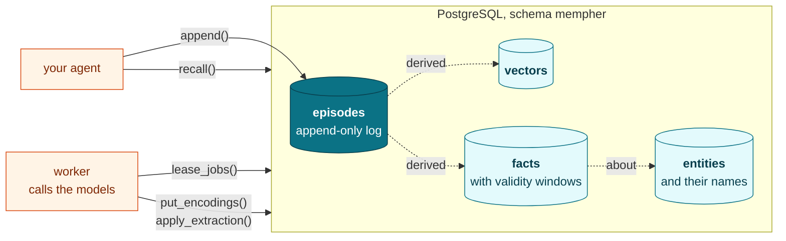
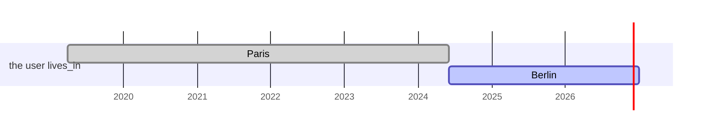
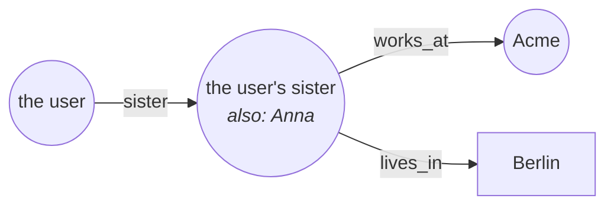

<div align="center">


# mempher

**Long-term memory for AI agents, built on PostgreSQL.**


[](https://github.com/gojargo/mempher/actions/workflows/ci.yml)
[](https://pkg.go.dev/github.com/gojargo/mempher)
[](https://securityscorecards.dev/viewer/?uri=github.com/gojargo/mempher)
[](LICENSE)

</div>

## What it is

mempher gives an agent a memory that lasts across conversations. You write
what was said. Later you ask a question and get back the relevant messages and
the facts known about the user.

It runs in one PostgreSQL database. There is no vector service, no graph
database and no sidecar. The logic is SQL functions in a `mempher` schema, so
any language that can run a query can use it. A Go client is included.

## How it works



1. **Append.** Each message is stored as an episode. Episodes are never
   changed. This step calls no model and takes one round trip.
2. **Consolidate.** A background worker embeds the episodes and asks a model
   to extract facts from them.
3. **Recall.** One SQL call searches the episodes by meaning and by words,
   reads the facts that are true now, and returns both within a token budget.

Episodes are the only source of truth. Vectors, facts and entities are derived
from them and can be deleted and rebuilt at any time.

## What is stored

| | Example | Table |
| --- | --- | --- |
| **Episode** | "I moved to Berlin in June." | `mempher.episodes` |
| **Fact** | the user, lives_in, Berlin, since 2024-06-01 | `mempher.facts` |
| **Entity** | "the user's sister", also called "Anna" | `mempher.entities` |

### Facts keep their history

When something changes, the old fact is closed at the date it stopped being
true. It is not overwritten.



"Where do they live?" returns Berlin. "Where did they live in 2020?" returns
Paris.

### Entities join the names of one thing

"My sister" and "Anna" can be the same person. mempher stores her facts under
one name, accepts either name in a query, and can follow the links between
entities.



More in [docs/entities.md](docs/entities.md).

## Quick start

```sh
docker run --rm -p 5432:5432 -e POSTGRES_PASSWORD=mempher pgvector/pgvector:pg18
go run ./examples/quickstart
```

The example needs no API key. It uses a small deterministic embedder and a few
rules in place of a model.

## Use it from SQL

```sql
-- Write.
SELECT * FROM mempher.append('user:8123',
  '[{"content": "I''m allergic to hazelnuts.", "role": "user", "source": "cli"}]',
  p_jobs := ARRAY['encode', 'extract']);

-- Read. $1 is the question's embedding.
SELECT mempher.recall('user:8123', 'any food allergies?',
  p_embedding  := $1,
  p_model      := 'text-embedding-3-small',
  p_extractor  := 'mempher-extract/v3+claude-opus-5+a3f9c1e2',
  p_max_tokens := 2000);

-- Erase a user, with everything derived from their episodes.
SELECT * FROM mempher.forget('user:8123');
```

The full list of functions is in [docs/sql-api.md](docs/sql-api.md).

## Use it from Go

```go
pool, _ := pgxpool.New(ctx, os.Getenv("DATABASE_URL"))

// Install or upgrade the schema.
postgres.Migrate(ctx, pool, postgres.MigrateOptions{
	VectorDimensions: embedder.Dimensions(),
})

store, _ := postgres.New(ctx, pool)
mem, _ := mempher.New(mempher.Config{
	Store: store, Embedder: embedder, Extractor: extractor,
})

// Write.
mem.Append(ctx, mempher.AppendRequest{
	Scope:   "user:8123",
	Content: "I'm allergic to hazelnuts.",
	Role:    mempher.RoleUser,
	Source:  "cli",
})

// Read.
rec, _ := mem.Recall(ctx, mempher.RecallRequest{
	Scope:     "user:8123",
	Query:     "any food allergies?",
	MaxTokens: 2000,
})
for _, f := range rec.Facts {
	fmt.Println(f.Fact.Statement)
}
for _, e := range rec.Episodes {
	fmt.Println(e.Episode.Content)
}

// Run the background worker.
w, _ := mempher.NewWorker(mempher.WorkerConfig{
	Store: store, Embedder: embedder, Extractor: extractor,
})
go w.Run(ctx)
```

Errors are omitted here. `embedder` and `extractor` are two small interfaces;
implementations for OpenAI-compatible and Anthropic APIs are included. See
[docs/models.md](docs/models.md).

## Requirements

- PostgreSQL 18 or newer
- the `vector` (pgvector), `btree_gin` and `btree_gist` extensions
- Go 1.27, for the Go client and the worker

## Documentation

| | |
| --- | --- |
| [Concepts](docs/concepts.md) | the log and its projections, validity windows, forgetting |
| [Entities](docs/entities.md) | aliases, merging, walking the graph |
| [SQL API](docs/sql-api.md) | every function, the error codes, writing a worker in another language |
| [Models](docs/models.md) | plugging in an embedder and an extractor |
| [Operations](docs/operations.md) | workers, backfill, the queue, rebuilding, testing |
| [Benchmarks](docs/benchmarks.md) | latency and retrieval quality |

## License

Apache-2.0. See [LICENSE](LICENSE).
