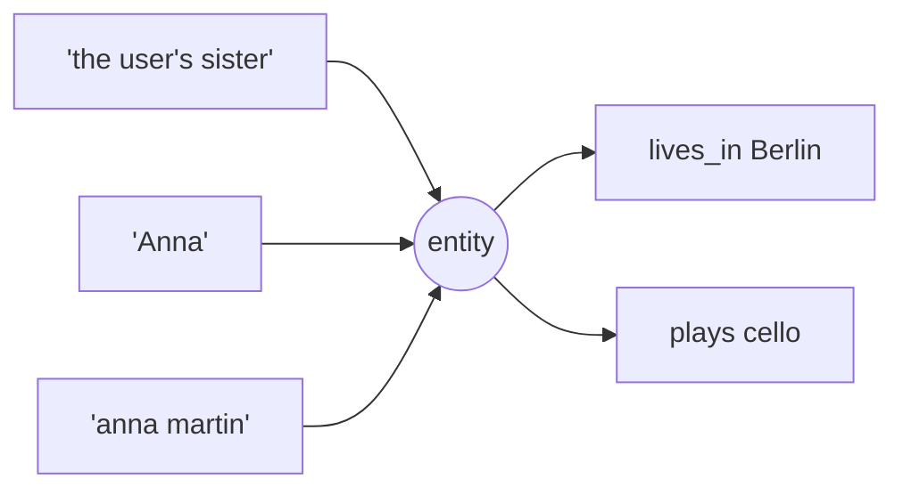
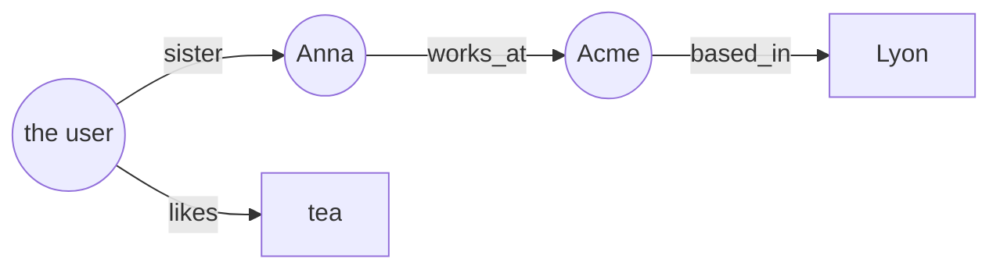

# Entities

## The problem

A fact's identity is its triple. That only works while the subject is spelled
one way. If one episode says "my sister" and the next says "Anna", an extractor
writes two subjects, and then:

- the same claim is stored twice,
- "Anna moved to Berlin" does not supersede "my sister lives in Paris",
- a question about Anna misses what is known about "my sister".

## The model

An entity is the thing behind the names. Each entity has one name, which is
the first spelling written, and any number of aliases.



| Table | Holds |
| --- | --- |
| `mempher.entities` | one row per entity: id, scope, extractor, name |
| `mempher.entity_aliases` | one row per name, the entity's own included; the primary key is (scope, extractor, normalised name) |

Two rules hold everywhere:

1. `mempher.facts.subject` is always the entity's name, never another alias.
   `apply_extraction` rewrites the subject before it writes.
2. Any function that takes a subject accepts any alias.

Names are compared without regard to case or to runs of whitespace. "The
User" and "the user" are one name. Nothing fuzzier is done automatically:
that "Anna" and "Anna Martin" are one person is a judgement, and it has to be
declared.

Entities belong to one extractor, as facts do.

## Declaring an alias

An extraction can declare aliases next to its assertions:

```sql
SELECT * FROM mempher.apply_extraction('user:8123', 'my-extractor', $1::uuid[],
  p_assert  := '[{"subject": "Anna", "predicate": "lives_in", "object": "Berlin",
                  "statement": "Anna lives in Berlin.", "valid_from": "2024-06-01"}]',
  p_aliases := '[{"alias": "Anna", "of": "the user''s sister"}]');
```

The fact is stored with the subject `the user's sister`.

An operator can declare one directly:

```sql
SELECT mempher.merge_entities('user:8123', 'my-extractor', 'Anna', 'the user''s sister');
```

If the alias is a new name, it is added. If it already names a different
entity, that entity is merged into the other:

- its names move to the surviving entity,
- its facts are rewritten to the surviving subject,
- where both held the same claim over overlapping windows, the surviving
  entity's fact is kept and gains the other's episodes as provenance.

Declaring the same alias twice changes nothing. There is no unmerge. A wrong
merge is repaired like any wrong extraction: rebuild L1 from the log.

The shipped extractor (`mempher/extract`) shows the model the names already
known and asks it to declare an alias only when the text says so.

## Reading

List the entities of a scope, or only those a text mentions:

```sql
SELECT name, aliases, facts FROM mempher.list_entities('user:8123', 'my-extractor');

SELECT name FROM mempher.list_entities('user:8123', 'my-extractor',
  p_mentioned_in := 'Is Anna still in Paris?');
```

Filter facts by any name:

```sql
SELECT statement FROM mempher.search_facts('user:8123', 'my-extractor',
  p_subjects := ARRAY['Anna']);
```

When the question passed to `search_facts` or `recall` names an entity, the
facts that touch it rank first. This never removes a fact from the result.

## The graph

Objects are stored as written. When an object is the name of an entity, the
fact links its subject to that entity. The facts of a scope are therefore a
graph, and `related_facts` walks it with a recursive CTE.



```sql
SELECT hops, statement FROM mempher.related_facts('user:8123', 'my-extractor',
  ARRAY['Acme'], p_hops := 1);
```

| hops | returns |
| --- | --- |
| 0 | facts that touch Acme as subject or object: where it is based, who works there |
| 1 | also the facts that touch Anna, who works there |
| 2 | also the facts of the user, whose sister she is |

`p_hops` is 0 to 8. Only facts true at `p_at` are followed.

## Erasure

`mempher.forget` on a whole scope removes every entity. On some episodes, it
removes the entities those episodes introduced that no remaining fact is
about, and the aliases those episodes added to the entities that stay.

Entities are not removed by truncating `mempher.facts`, because an alias
declared by hand would not come back on replay. To rebuild names as well:

```sql
TRUNCATE mempher.facts, mempher.fact_extractions;
TRUNCATE mempher.entities CASCADE;
```
