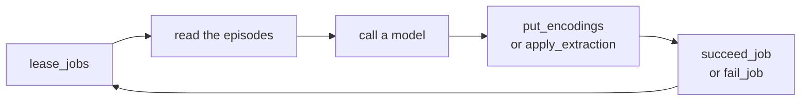

# The SQL API

Every rule mempher enforces is a function in the `mempher` schema. The Go
package calls these functions, and so can any client that speaks SQL. A
service in another language gets the same validation and the same guarantees.

Tables can be read directly. Writing is done through the functions.

## Functions

| Function | What it does |
| --- | --- |
| `append` | write 1 to 64 episodes of a scope and queue the jobs they imply, atomically |
| `recall` | run the channels, fuse, read the facts, spend the token budget; returns one JSON document |
| `search_facts` | read the facts true at an instant, ranked by meaning, by words and by the entities the question names |
| `related_facts` | read the facts within a number of hops of some entities |
| `list_entities` | list a scope's entities with their aliases, or only those a text mentions |
| `merge_entities` | declare that two names are one entity |
| `forget` | erase a scope or some of its episodes, with everything derived from them |
| `lease_jobs`, `succeed_job`, `fail_job`, `reclaim_jobs` | run the queue: leases, attempts, backoff, dead jobs |
| `put_encodings` | write a worker's episode vectors |
| `apply_extraction` | write a worker's extraction: assertions, retractions, aliases, read markers |
| `pending_fact_encodings`, `put_fact_encodings` | list the facts with no vector, and write vectors for them |
| `enqueue`, `retry_job`, `purge_jobs`, `job_stats`, `pending_episodes`, `enqueue_fact_encodings` | operate the queue and find work that is still owed |

Each public function has a `COMMENT ON FUNCTION` that describes its arguments;
`\df+ mempher.*` in psql lists them. Functions whose name starts with an
underscore are internal and may change.

## Examples

```sql
-- Write.
SELECT * FROM mempher.append('user:8123',
  '[{"content": "I''m allergic to hazelnuts.", "role": "user", "source": "cli"}]',
  p_jobs := ARRAY['encode', 'extract']);

-- Read. The query embedding is the one thing computed outside the database.
SELECT mempher.recall('user:8123', 'any food allergies?',
  p_embedding  := $1,
  p_model      := 'text-embedding-3-small',
  p_extractor  := 'mempher-extract/v3+claude-opus-5+a3f9c1e2',
  p_max_tokens := 2000);

-- What was true on a given day.
SELECT statement, valid FROM mempher.search_facts('user:8123',
  'mempher-extract/v3+claude-opus-5+a3f9c1e2', p_at := '2020-06-01');
```

## A worker in any language



An `encode_facts` job reads `pending_fact_encodings` and ends with
`put_fact_encodings`. Leases, retries, backoff and dead jobs are decided by
the queue functions.

## Conventions

- No function reads a clock it was not given. Every timestamp is a parameter
  that defaults to `now()`, so a replay produces the same rows.
- Every function is `SECURITY INVOKER` with a pinned `search_path`.
- Writes are idempotent where a retry is possible: applying the same
  extraction twice changes nothing the second time.
- An assertion of a claim already held over an overlapping window does not
  fail and does not add a row: the stored window stands and the fact gains
  the new episodes as provenance.

## Errors

A caller's mistake raises a SQLSTATE in class `MP`. The code is the contract;
the message is for a person. The Go package maps each code to a sentinel
error.

| Code | Meaning | Code | Meaning |
| --- | --- | --- | --- |
| `MP001` | invalid scope id | `MP012` | invalid extraction |
| `MP002` | invalid episode content | `MP013` | invalid argument |
| `MP003` | invalid role | `MP014` | invalid entity name |
| `MP004` | invalid source | `MP020` | not found |
| `MP005` | invalid actor | `MP021` | vector dimension mismatch |
| `MP006` | invalid binding | `MP022` | fact windows conflict |
| `MP007` | invalid channel | `MP023` | job not leased by this worker |
| `MP008` | invalid job kind | `MP024` | job is not dead |
| `MP009` | invalid job state | `MP025` | the same work is already queued |
| `MP010` | invalid fact | | |
| `MP011` | invalid validity window | | |

## Installing the schema

The schema is one migration,
[`0001_init.sql`](../postgres/migrations/0001_init.sql), rendered and applied
by `postgres.Migrate` from the Go package. It takes the vector width and the
text search configuration as options. Everything lives in the `mempher`
schema, so it installs next to an application schema and is removed by
dropping one schema.
